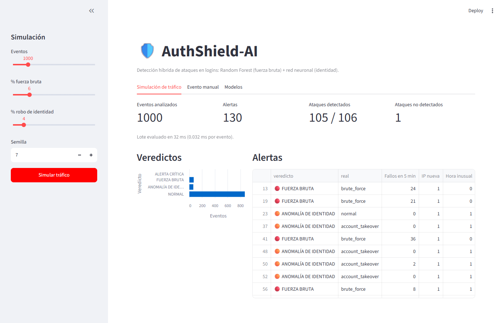
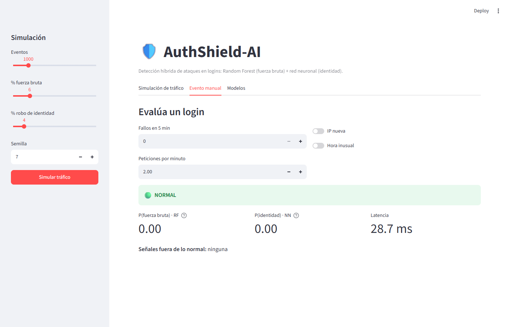
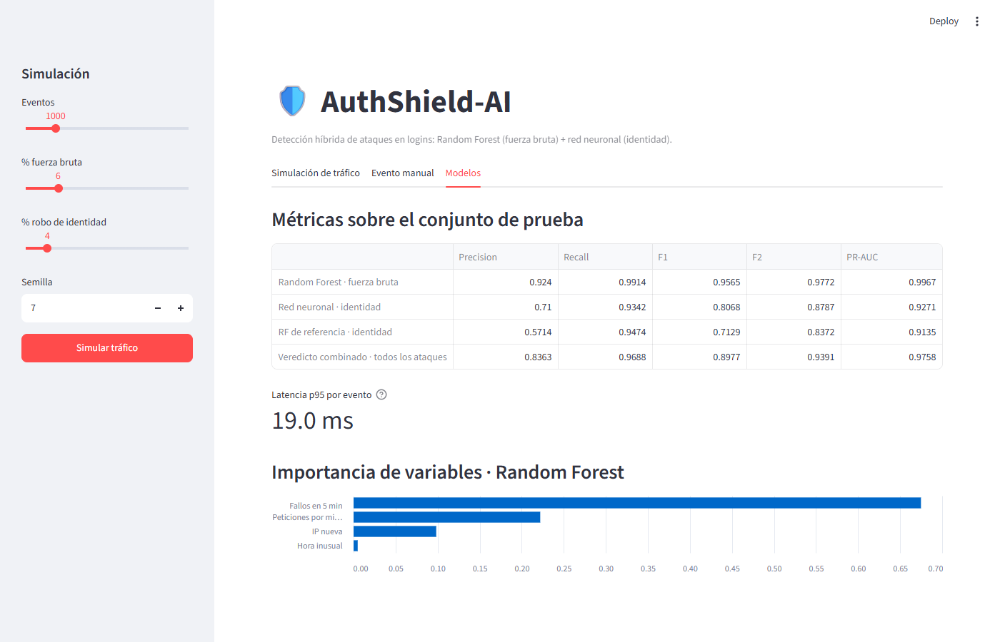
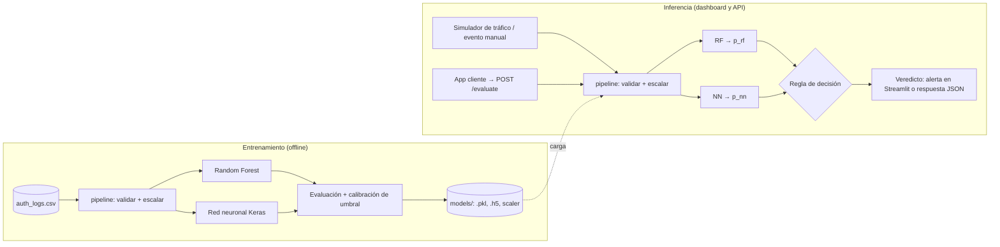

# AuthShield-AI

**Sistema híbrido de detección de anomalías en logs de autenticación**
Machine Learning clásico (Random Forest) + Deep Learning (red neuronal densa en Keras), con un dashboard de simulación en Streamlit y una API REST en FastAPI.



<details>
<summary>Más capturas: evaluación manual y métricas de los modelos</summary>




</details>

---

## Inicio rápido

**Con Docker Compose** (dashboard y API a la vez; incluye dataset y modelos ya entrenados):

```bash
cp .env.example .env       # y pon tu clave en AUTHSHIELD_API_KEYS
docker compose up --build -d
# Dashboard en http://localhost:8501 · API en http://localhost:8000 (/docs)
docker compose ps          # ambos servicios deben quedar "healthy"
docker compose down
```

**Con Docker, servicio por servicio:**

```bash
docker build -t auth-shield-ai .
docker run --rm -p 8501:8501 auth-shield-ai
# Dashboard en http://localhost:8501

docker run --rm -p 8000:8000 -e AUTHSHIELD_API_KEYS="<tu-clave>" \
  auth-shield-ai uvicorn app.api:app --host 0.0.0.0 --port 8000
# API en http://localhost:8000 · documentación interactiva en /docs (botón "Authorize")
```

**API key.** La API no arranca sin al menos una clave de 32 caracteres o más. Para generar una:

```bash
python -c "import secrets; print(secrets.token_urlsafe(32))"
```

`AUTHSHIELD_API_KEYS` admite varias claves separadas por comas, para rotarlas sin cortar el servicio: se añade la nueva, se migran los clientes y se retira la vieja.

**Límite de peticiones.** Cada API key puede hacer `AUTHSHIELD_RATE_LIMIT_PER_MIN` peticiones por minuto (60 por defecto), contadas en una ventana deslizante de 60 s. Al pasarse, la API responde `429` con la cabecera `Retry-After`, que indica los segundos que hay que esperar. Las peticiones con clave inválida no consumen el límite de nadie.

| Variable | Obligatoria | Por defecto | Descripción |
|---|---|---|---|
| `AUTHSHIELD_API_KEYS` | Sí | — | Claves válidas separadas por comas, de 32 caracteres o más. |
| `AUTHSHIELD_RATE_LIMIT_PER_MIN` | No | `60` | Peticiones por minuto y por clave. Un valor inválido impide arrancar. |

**En local** (Python 3.12):

```bash
python -m venv .venv
.venv/Scripts/activate            # Windows  ·  source .venv/bin/activate en Linux/macOS
pip install -r requirements.txt

python -m src.pipeline            # genera data/auth_logs.csv (opciones: --events, --seed, ...)
python -m src.train               # entrena ambos modelos y guarda models/
streamlit run app/dashboard.py     # dashboard
AUTHSHIELD_API_KEYS="<tu-clave>" uvicorn app.api:app --port 8000    # API
```

**Evaluar un login con la API:**

```bash
curl -X POST http://localhost:8000/evaluate \
  -H "Content-Type: application/json" \
  -H "X-API-Key: <tu-clave>" \
  -d '{"failed_logins_5m": 0, "is_new_ip": 1, "unusual_hour": 1, "requests_per_minute": 9}'
# {"p_rf":0.0,"p_nn":0.9964,"verdict":"ANOMALÍA DE IDENTIDAD","latency_ms":10.05}
# Sin clave o con una clave incorrecta: 401 {"detail":"API key inválida o ausente"}
# Por encima del límite: 429 {"detail":"Límite de peticiones superado"} + Retry-After
```

**Pruebas y lint:**

```bash
pip install pytest httpx ruff
python -m pytest -q
ruff check .
```

---

## Índice

1. [Objetivo del sistema](#1-objetivo-del-sistema)
2. [Requerimientos funcionales (RF)](#2-requerimientos-funcionales-rf)
3. [Requerimientos no funcionales (RNF)](#3-requerimientos-no-funcionales-rnf)
4. [Diseño de variables (features)](#4-diseño-de-variables-features)
5. [Métricas de ingeniería de software](#5-métricas-de-ingeniería-de-software)
6. [Arquitectura conceptual](#6-arquitectura-conceptual)
7. [Alcance, supuestos y riesgos](#7-alcance-supuestos-y-riesgos)
8. [Resultados](#8-resultados)
9. [Publicación en internet](#9-publicación-en-internet)

---

## 1. Objetivo del sistema

### 1.1 Problema

En la gestión de identidades y accesos (IAM), el login es la puerta de entrada a todos los demás controles. Si un atacante consigue autenticarse, el resto de permisos ya no lo frena. Los dos vectores que este sistema ataca son:

| Vector | Cómo se manifiesta en los logs |
|---|---|
| **Fuerza bruta / password spraying / credential stuffing** | Muchos intentos fallidos en poco tiempo, ritmo de peticiones que ningún humano alcanza. |
| **Robo de identidad (account takeover)** | Un login **correcto** pero hecho desde una IP desconocida, a una hora atípica para ese usuario. No genera fallos, así que las reglas basadas en contar errores no lo ven. |

Las reglas estáticas (“bloquear tras 5 fallos”) tienen dos problemas: son fáciles de evadir (el atacante baja el ritmo justo por debajo del umbral) y no ven combinaciones de señales débiles que, juntas, sí son sospechosas.

### 1.2 Propuesta

AuthShield-AI evalúa cada evento de autenticación con **dos modelos especializados**, uno por vector de ataque, y devuelve un veredicto de riesgo:

- **Random Forest (Scikit-Learn) → fuerza bruta.** Clasifica patrones volumétricos, directos y conocidos (muchos fallos, ritmo alto). Es interpretable (importancia de variables) y robusto con pocas variables.
- **Red neuronal secuencial (TensorFlow/Keras) → anomalías de identidad.** Analiza correlaciones sutiles y probabilísticas entre señales débiles (IP nueva + hora atípica + login correcto), que es donde se esconde el robo de identidad.

Los dos modelos reciben las mismas 4 variables, pero cada uno se entrena para reconocer su propio tipo de ataque. El veredicto final combina ambos e indica **qué tipo** de ataque se sospecha (ver [6.3](#63-regla-de-decisión-combinada)).

### 1.3 Propósito del proyecto

Es un proyecto de portafolio de Ingeniería de Sistemas. Su objetivo es mostrar, de punta a punta, el diseño de un sistema de seguridad con ML: datos, entrenamiento, evaluación con métricas adecuadas al dominio, inferencia de baja latencia, interfaz demostrable y automatización DevSecOps. No pretende sustituir a un producto IAM comercial.

---

## 2. Requerimientos funcionales (RF)

| ID | Requerimiento | Descripción | Criterio de aceptación |
|---|---|---|---|
| **RF-01** | Simulación de tráfico de autenticación | Generar eventos sintéticos de login, tanto legítimos como maliciosos (fuerza bruta, robo de identidad), con proporciones configurables (`src/pipeline.py`). Sirve para construir `data/auth_logs.csv` y para alimentar el dashboard en vivo. | Se puede elegir el número de eventos y el % de cada tipo de ataque; cada evento trae las 4 features y sus etiquetas (ver [4.4](#44-etiquetas)). |
| **RF-02** | Pipeline de preprocesamiento | Validar, limpiar y escalar las features con un único pipeline que se usa igual en entrenamiento y en inferencia (`src/pipeline.py`). | Un evento con tipos o rangos inválidos se rechaza con un error explícito, nunca se puntúa en silencio. El scaler se ajusta **solo** con el conjunto de entrenamiento. |
| **RF-03** | Entrenamiento de ambos modelos | Entrenar, con el mismo split estratificado (`src/train.py`), el Random Forest para detectar fuerza bruta y la red neuronal para detectar anomalías de identidad. Reportar las métricas de la sección 5 sobre un conjunto de prueba que no se usó para entrenar. | Se genera un reporte con matriz de confusión, Precision, Recall, F1, F2 y PR-AUC para cada modelo (sobre su tipo de ataque) y para el veredicto combinado (sobre todos los ataques). |
| **RF-04** | Guardado automático de artefactos | Al terminar el entrenamiento, persistir sin intervención manual `models/ml_auth_model.pkl`, `models/dl_auth_model.h5` y `models/scaler.pkl`. | El dashboard arranca solo con esos artefactos (más `models/metadata.json`, con umbrales y métricas), sin reentrenar. Si falta alguno, muestra un error claro en lugar de fallar a mitad de camino. |
| **RF-05** | Evaluación concurrente por ambos modelos | Cada evento se puntúa con los dos modelos sobre el mismo vector escalado. El RF devuelve la probabilidad de fuerza bruta, la NN la de anomalía de identidad, y el sistema emite un veredicto combinado (ver [6.3](#63-regla-de-decisión-combinada)). | La salida por evento incluye `p_rf`, `p_nn`, el veredicto final con el tipo de ataque sospechado y la latencia medida. |
| **RF-06** | Despliegue visual de alertas | El dashboard de Streamlit (`app/dashboard.py`) muestra el flujo simulado, las alertas por nivel de severidad, la comparación entre modelos y sus métricas. | Las alertas se distinguen por color **y** por texto/icono (no solo por color). Hay una vista de “evento manual” donde el usuario ajusta las 4 features y ve el veredicto al instante. |
| **RF-07** | Explicabilidad básica | Mostrar por qué se marcó un evento: importancia global de variables del Random Forest y valores del evento comparados con lo normal. | Cada alerta muestra qué features estaban fuera de rango. |
| **RF-08** | API de evaluación | Microservicio HTTP (`app/api.py`, FastAPI) para que cualquier aplicación envíe un evento de login y reciba el veredicto. `POST /evaluate` (exige la cabecera `X-API-Key`) y `GET /health` (abierto, para orquestadores). | Sin clave válida: 401, antes de validar el cuerpo. Por encima del límite por clave: 429 con `Retry-After`. Cuerpo mayor de 1 KB: 413; sin `Content-Length`: 411 (ambos antes de autenticar). Una entrada inválida (tipos, rangos, campos faltantes o desconocidos) recibe un 422 sin llegar a los modelos. La respuesta incluye `p_rf`, `p_nn`, el veredicto y la latencia. |

---

## 3. Requerimientos no funcionales (RNF)

| ID | Categoría | Requerimiento | Cómo se verifica |
|---|---|---|---|
| **RNF-01** | Rendimiento — latencia | La inferencia de **un evento** (validación + escalado + ambos modelos + regla de decisión) debe tardar **< 50 ms en el percentil 95**, en CPU, sin GPU. | Benchmark de 1 000 inferencias individuales tras un calentamiento; se reportan p50, p95 y p99. *Nota de diseño:* `model.predict()` de Keras arrastra sobrecarga por llamada; para eventos individuales se invocará el modelo directamente (`model(x)`) o en lote. |
| **RNF-02** | Rendimiento — throughput | El modo simulación debe procesar lotes de al menos 1 000 eventos por segundo usando inferencia vectorizada. | Medición en el benchmark de lote. |
| **RNF-03** | Desacoplamiento | La lógica de datos y modelos (`src/`) no depende de Streamlit. El dashboard (`app/`) solo consume artefactos y funciones públicas de `src/`. | `src/` se importa y se prueba sin tener Streamlit instalado. |
| **RNF-04** | Modularidad | Cada módulo tiene una sola responsabilidad: `pipeline.py` transforma datos, `train.py` entrena y persiste, `dashboard.py` presenta. Cambiar o añadir un modelo no obliga a tocar el pipeline ni la UI más allá de registrarlo. | Revisión de dependencias entre módulos. |
| **RNF-05** | Mantenibilidad | Código con tipado (*type hints*), docstrings en funciones públicas, linter y formateador en CI, y pruebas automáticas del pipeline y de la regla de decisión. | El pipeline de CI falla si fallan el lint o las pruebas. |
| **RNF-06** | Reproducibilidad | Semillas fijas (`random_state`, semilla de TensorFlow), dependencias con versión fijada en `requirements.txt` e imagen Docker reproducible. | Dos entrenamientos con la misma semilla y los mismos datos dan métricas idénticas (RF) o casi idénticas (NN, por no determinismo de CPU). |
| **RNF-07** | Seguridad del propio sistema | Los artefactos `.pkl` se pueden ejecutar al deserializarse: solo se cargan desde `models/` y nunca se aceptan subidos por el usuario. La imagen Docker corre con un usuario no root. CI incluye escaneo de dependencias y de secretos. La API exige API key: las claves llegan por variable de entorno (nunca en el código), se comparan en tiempo constante, y sin claves el servicio no arranca. Cada clave tiene un límite de peticiones por minuto. | Revisión del Dockerfile y de los pasos de CI; pruebas de 401, 429 y de arranque en `tests/test_api.py`. |
| **RNF-08** | Privacidad | Los datos son sintéticos. Si en el futuro se usan logs reales, las IP y los identificadores de usuario se seudonimizan (hash) antes de entrar al pipeline. | Revisión del generador y del esquema de datos. |
| **RNF-09** | Portabilidad | El sistema completo (entrenamiento y dashboard) se levanta con un solo `docker build` + `docker run`. | Lo comprueba el pipeline de CI. |

---

## 4. Diseño de variables (features)

Cada evento de autenticación se resume en cuatro variables, calculadas **por usuario** (o por IP en el caso de spraying) en el momento del intento.

| Variable | Tipo | Rango | Definición |
|---|---|---|---|
| `failed_logins_5m` | Entero | `0 … n` | Intentos fallidos en la ventana deslizante de los últimos 5 minutos. |
| `is_new_ip` | Binaria | `0 / 1` | `1` si la IP de origen nunca se ha visto para ese usuario en su historial. |
| `unusual_hour` | Binaria | `0 / 1` | `1` si el intento ocurre fuera de la franja horaria habitual del usuario (en la simulación, una franja nocturna fija, p. ej. 00:00–05:59). |
| `requests_per_minute` | Real | `≥ 0` | Ritmo de peticiones de autenticación desde ese origen en el último minuto. |

### 4.1 Justificación por variable

- **`failed_logins_5m` — fuerza bruta.** Un humano que olvidó su contraseña falla 1 a 3 veces. Un ataque de diccionario genera decenas en minutos. La ventana de 5 minutos es lo bastante corta para reaccionar a tiempo y lo bastante larga para detectar a quien espacia los intentos y así esquivar un bloqueo por segundo.
- **`is_new_ip` — robo de identidad.** Con credenciales robadas, el atacante entra **a la primera**, desde su propia infraestructura. Una IP nunca vista es la señal más directa de que quien se autentica no es el dueño habitual de la cuenta. Por sí sola no basta (viajes, cambio de red móvil), y por eso se combina con las demás.
- **`unusual_hour` — robo de identidad y automatización.** Los ataques suelen lanzarse desde otras zonas horarias o en horarios de baja vigilancia. Un acceso a las 3:00 a una cuenta que siempre entra en horario laboral es atípico, aunque la contraseña sea correcta.
- **`requests_per_minute` — automatización y bots.** Distingue a un humano (pocas peticiones por minuto) de herramientas como Hydra o scripts de credential stuffing (cientos). Detecta ataques distribuidos por muchas cuentas que se quedan por debajo del umbral de fallos de cada cuenta individual.

### 4.2 Por qué combinar variables (y por qué ML)

| Escenario | `failed_logins_5m` | `is_new_ip` | `unusual_hour` | `requests_per_minute` | Lectura |
|---|---|---|---|---|---|
| Usuario normal | 0 | 0 | 0 | bajo | Legítimo |
| Usuario que olvidó la contraseña | 2 | 0 | 0 | bajo | Legítimo |
| Usuario de viaje | 0 | 1 | 1 | bajo | Ambiguo → revisión |
| Fuerza bruta | alto | 1 | 0/1 | alto | Ataque |
| **Robo de identidad** | **0** | **1** | **1** | **bajo** | **Ataque sin ningún fallo** |

Los dos últimos casos son el argumento del sistema. Ninguna variable por separado separa al “usuario de viaje” del “robo de identidad”: la diferencia está en combinaciones y en matices que una regla fija no captura y un modelo sí aprende de los datos.

### 4.3 Preprocesamiento

- Las variables binarias se pasan sin transformar.
- `failed_logins_5m` y `requests_per_minute` tienen colas largas: se transforman con `log1p` y luego se estandarizan con el `scaler.pkl` ajustado en entrenamiento. La red neuronal lo necesita para converger. Al Random Forest no le afecta, pero recibe el mismo vector para que ambos modelos compartan una única ruta de inferencia.
- Los valores fuera de rango (negativos, binarias distintas de 0/1) se rechazan en la validación (RF-02).

### 4.4 Etiquetas

Cada evento del dataset lleva dos columnas de verdad:

| Columna | Valores | Uso |
|---|---|---|
| `attack_type` | `normal`, `brute_force`, `account_takeover` | Fuente de verdad. De ella se derivan los objetivos de cada modelo. |
| `label` | `0` = normal, `1` = cualquier ataque | Objetivo del veredicto combinado y de las métricas globales. |

- **Objetivo del Random Forest:** `attack_type == brute_force`.
- **Objetivo de la red neuronal:** `attack_type == account_takeover`.

Así cada modelo aprende solo su especialidad, y el veredicto combinado se evalúa contra `label`.

---

## 5. Métricas de ingeniería de software

### 5.1 Por qué el Accuracy no sirve

En autenticación, los ataques son una minoría. Si el 2 % de los eventos son ataques, un “modelo” que siempre responde *normal* obtiene un **98 % de Accuracy** y no detecta ninguno. El Accuracy premia a la clase mayoritaria y esconde justo lo que importa.

### 5.2 Matriz de confusión en contexto de seguridad

|  | Predicho: normal | Predicho: anómalo |
|---|---|---|
| **Real: normal** | Verdadero negativo (TN) | **Falso positivo (FP)**: un usuario legítimo es bloqueado o desafiado. Coste: fricción y carga en soporte. |
| **Real: anómalo** | **Falso negativo (FN)**: un atacante entra sin ser detectado. Coste: compromiso de la cuenta, filtración de datos. | Verdadero positivo (TP) |

**Los dos errores no cuestan lo mismo.** Un FP se resuelve con un segundo factor o una llamada a soporte. Un FN puede significar una brecha completa. Por eso el sistema prioriza reducir los falsos negativos.

### 5.3 Métricas y su significado

$$\text{Precision} = \frac{TP}{TP + FP} \qquad \text{Recall} = \frac{TP}{TP + FN}$$

- **Recall (sensibilidad):** de todos los ataques reales, cuántos se detectan. Es **la métrica principal**: cada falso negativo resta directamente aquí.
- **Precision:** de todas las alertas, cuántas eran ataques de verdad. Mide la fatiga de alertas: si es baja, el equipo de seguridad termina ignorando el sistema.

$$F_1 = 2 \cdot \frac{\text{Precision} \cdot \text{Recall}}{\text{Precision} + \text{Recall}}$$

- **F1-Score:** media **armónica** de Precision y Recall. A diferencia de la media aritmética, se hunde si cualquiera de las dos es baja: un modelo con Recall 1.0 y Precision 0.1 tiene F1 ≈ 0.18, no 0.55. Por eso impide “hacer trampa” marcando todo como ataque y es la métrica de referencia para comparar modelos con clases desbalanceadas.

$$F_\beta = (1 + \beta^2) \cdot \frac{\text{Precision} \cdot \text{Recall}}{\beta^2 \cdot \text{Precision} + \text{Recall}}$$

- **F2-Score (β = 2):** da al Recall el **doble de peso** que a la Precision. Formaliza matemáticamente la decisión de que un FN es peor que un FP y se usa para **elegir el umbral de decisión**.
- **PR-AUC (área bajo la curva Precision-Recall):** calidad del modelo en todos los umbrales posibles. Con clases desbalanceadas es más honesta que la ROC-AUC, que se ve inflada por la gran cantidad de verdaderos negativos.

### 5.4 Objetivos de aceptación

Medidos sobre el conjunto de prueba, con el veredicto combinado contra `label`. Además, cada modelo se mide por separado contra su propio objetivo (4.4), para saber cuál falla cuando se escapa un ataque.

| Métrica | Objetivo | Motivo |
|---|---|---|
| **Recall** | **≥ 0.95** | Restricción dura: como mucho 1 de cada 20 ataques pasa sin detectar. |
| F1-Score | ≥ 0.90 | Equilibrio global entre detección y ruido. |
| Precision | ≥ 0.85 | Mantener la fatiga de alertas en un nivel manejable. |
| PR-AUC | ≥ 0.95 | Calidad del modelo independiente del umbral. |
| Latencia p95 | < 50 ms | RNF-01. |

**Política de umbral:** el umbral de cada modelo se calibra en un conjunto de validación (separado del de prueba) como el que **maximiza F2 sujeto a Recall ≥ 0.95**. Si hay que ceder, se cede Precision, no Recall.

### 5.5 Técnicas para reducir falsos negativos

- **Split estratificado** para que entrenamiento, validación y prueba tengan la misma proporción de ataques.
- **Ponderación de clases** (`class_weight`) en ambos modelos, para que equivocarse con la clase minoritaria cueste más durante el entrenamiento.
- **Umbral ajustado** según la política anterior, en lugar del 0.5 por defecto.
- **Regla de decisión combinada orientada al Recall** (sección 6.3): basta con que un modelo sospeche para que el evento no pase como normal.

---

## 6. Arquitectura conceptual

### 6.1 Componentes y responsabilidades

| Componente | Ubicación | Responsabilidad |
|---|---|---|
| Datos | `data/auth_logs.csv` | Dataset histórico/simulado etiquetado (4 features + etiqueta). |
| Pipeline | `src/pipeline.py` | Simulación de eventos y generación de `data/auth_logs.csv` (RF-01), validación del esquema, escalado, carga de artefactos e inferencia con la regla combinada. |
| Entrenamiento | `src/train.py` | Split estratificado, entrenamiento del RF y la NN, calibración de umbrales, evaluación, medición de latencia y persistencia de artefactos. |
| Artefactos | `models/` | `ml_auth_model.pkl` (RF), `dl_auth_model.h5` (NN), `scaler.pkl` y `metadata.json` (umbrales, métricas, latencia). Son la única interfaz entre el entrenamiento y la inferencia. |
| Dashboard | `app/dashboard.py` | Simulación de tráfico, evaluación en vivo, alertas, métricas y vista de evento manual. `.streamlit/config.toml` lo prepara para demo pública: sin barra de desarrollo ni telemetría. |
| API | `app/api.py` | Microservicio FastAPI: exige API key, aplica el límite por clave, valida el evento en la entrada, lo puntúa con `score()` y devuelve el veredicto. Carga los modelos y los calienta al arrancar. |
| Pruebas | `tests/` | Simulador, validación, escalado, regla de decisión y calibración de umbrales. |
| CI/CD | `.github/workflows/ci-cd.yml` | Lint, pruebas, escaneo de seguridad, entrenamiento de verificación y build de la imagen Docker. |
| Contenedor | `Dockerfile` | Empaqueta dependencias y aplicación con un usuario no root. |

### 6.2 Flujo de datos



El límite entre ambos mundos son los artefactos de `models/`: el dashboard nunca entrena y el entrenamiento nunca depende de la UI (RNF-03).

### 6.3 Regla de decisión combinada

Cada modelo compara su probabilidad con su umbral calibrado:

| RF (fuerza bruta) | NN (identidad) | Veredicto | Lectura en el dashboard |
|---|---|---|---|
| Sí | Sí | 🔴 **ALERTA CRÍTICA** | Fuerza bruta con indicios de suplantación: ataque activo contra la cuenta. |
| Sí | No | 🔴 **ALERTA — fuerza bruta** | Ataque volumétrico. Acción sugerida: bloqueo temporal de la IP. |
| No | Sí | 🟠 **ALERTA — anomalía de identidad** | Login posiblemente suplantado. Acción sugerida: verificación adicional (MFA), porque puede ser un usuario legítimo de viaje. |
| No | No | 🟢 **NORMAL** | Sin acción. |

Es una regla **OR orientada al Recall**: basta con que uno de los dos especialistas reconozca su patrón para que el evento no pase como normal. Para que un ataque se escape tiene que fallar el modelo de su especialidad. La severidad distinta para identidad (🟠) evita que la ambigüedad de ese caso termine en bloqueos directos a usuarios legítimos.

### 6.4 Modelos

| Aspecto | Random Forest | Red neuronal (Keras) |
|---|---|---|
| Especialidad | Fuerza bruta (`attack_type == brute_force`) | Anomalía de identidad (`attack_type == account_takeover`) |
| Tipo | Ensamble de 150 árboles (profundidad máx. 12) | Modelo `Sequential` denso: 4 → 32 → 16 → 1, salida sigmoide |
| Fortaleza | Interpretable (importancia de variables), robusto, poco sensible al escalado | Fronteras de decisión suaves y no lineales |
| Desbalance | `class_weight="balanced"` | `class_weight` en el entrenamiento |
| Regularización | Profundidad máxima, mínimo de muestras por hoja | Dropout, early stopping sobre el conjunto de validación |
| Artefacto | `models/ml_auth_model.pkl` | `models/dl_auth_model.h5` |

---

## 7. Alcance, supuestos y riesgos

### 7.1 Fuera de alcance (Fase 1)

- Integración con un proveedor de identidad real (Supabase Auth, Keycloak, Auth0).
- Variables avanzadas: geolocalización, “viaje imposible”, huella del dispositivo, reputación de la IP.
- Respuesta automática (bloqueo real de cuentas). El sistema **detecta y alerta**, no actúa.
- Límite de peticiones compartido entre procesos: el contador vive en memoria de cada proceso. Con un solo worker es exacto; con varios workers o réplicas, cada uno cuenta por su lado y el límite real se multiplica. Al escalar, hay que moverlo a Redis o al gateway.
- Límite por IP para peticiones sin clave válida: no se limitan, porque adivinar una clave de 32 caracteres aleatorios no es viable. Contra una inundación de tráfico, se apoya en el proxy o CDN que esté delante.
- Reentrenamiento continuo y detección de *drift* en producción.

### 7.2 Supuestos

- Los datos de entrenamiento son **sintéticos**, generados con el simulador de RF-01.
- Las features llegan ya calculadas por evento; agregarlas desde logs crudos queda para una fase posterior.

### 7.3 Riesgos de diseño

| Riesgo | Impacto | Mitigación |
|---|---|---|
| **Fuga de etiqueta en datos sintéticos.** Si el generador etiqueta ataques con reglas deterministas sobre las mismas 4 features, los modelos solo reaprenden esas reglas y las métricas salen artificialmente perfectas. | Métricas engañosas que no dicen nada del modelo. | El generador introduce **solapamiento realista**: usuarios legítimos de viaje, ataques lentos y ruido en las distribuciones. Un F1 = 1.0 se trata como señal de alarma, no como éxito. |
| Con solo 4 variables, la NN puede no superar a un modelo más simple en la detección de identidad. | La NN aporta poco frente a su coste. | Se entrena también un RF de referencia para identidad y la comparación se documenta. Es un resultado válido; el valor del diseño está en la especialización y la regla combinada. |
| Ataques mixtos (fuerza bruta desde IP nueva y a hora atípica). | Ambos especialistas se activan a la vez. | Es el comportamiento deseado: produce la ALERTA CRÍTICA (6.3). El simulador debe incluir estos casos. |
| Deserialización insegura de `.pkl`. | Ejecución de código arbitrario. | RNF-07: los artefactos solo se cargan desde `models/` y se generan dentro del propio pipeline. |
| Sobrecarga de inferencia de Keras por llamada. | Incumplir los 50 ms. | Invocación directa del modelo y calentamiento previo (RNF-01). |

---

## 8. Resultados

Conjunto de prueba (4 000 eventos, 20 % del dataset, nunca vistos en entrenamiento ni en la calibración de umbrales). Semilla 42. Valores tomados de `models/metadata.json`.

| Modelo | Tarea | Precision | Recall | F1 | F2 | PR-AUC |
|---|---|---|---|---|---|---|
| Random Forest | Fuerza bruta | 0.924 | **0.991** | 0.957 | 0.977 | 0.997 |
| Red neuronal | Robo de identidad | 0.710 | 0.934 | 0.807 | 0.879 | 0.927 |
| RF de referencia | Robo de identidad | 0.571 | 0.947 | 0.713 | 0.837 | 0.914 |
| **Veredicto combinado** | **Todos los ataques** | **0.836** | **0.969** | **0.898** | **0.939** | **0.976** |

**Frente a los objetivos de la sección 5.4:**

| Métrica | Objetivo | Obtenido | |
|---|---|---|---|
| Recall | ≥ 0.95 | 0.969 | ✅ |
| F1-Score | ≥ 0.90 | 0.898 | ⚠️ Por poco |
| Precision | ≥ 0.85 | 0.836 | ⚠️ Por poco |
| PR-AUC | ≥ 0.95 | 0.976 | ✅ |
| Latencia p95 | < 50 ms | 19 ms | ✅ |

**Lectura:**

- **Se cumple la restricción dura.** Solo se escapan 12 de 385 ataques (Recall 0.969) y la latencia p95 por evento queda muy por debajo de los 50 ms.
- **La fuerza bruta es casi un problema resuelto** con estas variables: `failed_logins_5m` y `requests_per_minute` concentran el 90 % de la importancia del Random Forest.
- **El robo de identidad es el caso difícil.** Un ataque con la contraseña correcta, desde una IP nueva y de madrugada se parece mucho a un usuario legítimo de viaje: con solo 4 variables, ese solapamiento es irreducible. Ahí se pierde la Precision combinada.
- **La red neuronal sí aporta.** En la misma tarea de identidad supera al RF de referencia en F1 (0.807 frente a 0.713) con un Recall comparable: es el argumento empírico del diseño híbrido.
- **Siguiente mejora natural:** añadir variables que distingan al viajero del atacante (viaje imposible, huella del dispositivo, reputación de la IP), fuera del alcance de esta fase (7.1).

---

## 9. Publicación en internet

Fase 1 (endurecimiento) completada; plataforma, despliegue continuo y verificación pública pendientes. Detalle y medidas en [`docs/despliegue.md`](docs/despliegue.md).
